# Optional passive SIEM integration with Wazuh

## 1. Purpose

A SIEM can collect and correlate selected host and application security events, help an operator notice service failures, and preserve a second operational view of the experiment. Wazuh is one possible open-source example. It is optional. The research application and its separated collector work without Wazuh.

For this project, the desired SIEM role was **passive monitoring**. It may receive and index selected events, generate alerts for an operator, and retain records for a configured period. It must not block requests, change firewall rules, kill processes, disable accounts, run remote commands, or otherwise intervene in the experimental run. This keeps the SIEM from becoming an unrecorded treatment arm.

Wazuh is a SIEM/XDR platform with an agent, manager, indexer, and dashboard components. The exact ports and supported deployment guidance can change, so check current official documentation before installing it:

- [Wazuh architecture](https://documentation.wazuh.com/current/getting-started/architecture.html)
- [Wazuh Docker deployment](https://documentation.wazuh.com/current/deployment-options/docker/wazuh-container.html)
- [Wazuh Quickstart sizing](https://documentation.wazuh.com/current/quickstart.html)
- [Wazuh JSON log collection](https://documentation.wazuh.com/current/user-manual/reference/ossec-conf/localfile.html)
- [Wazuh Active Response configuration](https://documentation.wazuh.com/current/user-manual/reference/ossec-conf/active-response.html)
- [Agent connection requirements](https://documentation.wazuh.com/current/user-manual/agent/agent-enrollment/requirements.html)

## 2. Placement options

### Preferred: a third private SIEM VM

Run the Wazuh manager, indexer, and dashboard on a dedicated private VM or supported managed platform. Keep the Wazuh dashboard and API private behind IAP or a VPN. Install a Wazuh agent on the target and telemetry hosts, configured only to read approved event files and host security logs. Permit agent traffic to the manager from those private source addresses only.

This isolates SIEM CPU, memory, indexing, and failure behavior from the target and telemetry database. It is easier to maintain clear firewall and administrator boundaries. The tradeoff is additional infrastructure cost and administration.

### Lower cost: place Wazuh on the private telemetry VM

This reduces the number of VMs but puts the SIEM, operator interface, collector, and telemetry database in one host failure domain. Indexing bursts compete with event ingestion and dashboard queries for CPU, memory, disk, and I/O. A Wazuh or Docker issue can affect both monitoring and primary telemetry. Use this only for a small short-lived study after sizing the VM and load testing the combined stack.

Do not place the SIEM manager or dashboard on the public target VM. That would put the security monitoring control plane on the same host exposed to the intentionally vulnerable application. It would also create a path from target compromise to SIEM data and credentials.

The Wazuh Quickstart documentation provides baseline sizing for a small all-in-one deployment. Its current guidance should be checked at the time of deployment. A single-node Wazuh deployment is substantially heavier than the Tarnhaven application containers.

## 3. Data flow for this project

The intended passive flow is:

```mermaid
flowchart LR
  app[Tarnhaven app event logger]
  docker[Docker JSON log file]
  adapter[Restricted log adapter<br/>unwrap and validate lines]
  ndjson[Host event file<br/>one JSON object per line]
  agent[Wazuh agent<br/>read only collection]
  manager[Private Wazuh manager]
  indexer[(Private Wazuh indexer)]
  dashboard[Dashboard via IAP]

  app -->|WAZUH_EXPORT_NDJSON=1| docker
  docker --> adapter --> ndjson --> agent
  agent -->|private authenticated channel| manager
  manager --> indexer --> dashboard
```



The application can emit a structured event line to standard output when `WAZUH_EXPORT_NDJSON=1`. (This flag exists in the app configuration).

The safer integration pattern is a small host-side adapter that reads the Docker log stream, extracts the `log` field, checks that it is a valid expected Tarnhaven event, and writes one event object per line to a dedicated file such as `/var/log/tarnhaven/events.ndjson`. Give the adapter access only to the relevant log files and output file. Do not mount the Docker socket into the app, Wazuh agent, or an internet-facing container. Do not create a general Docker API proxy.

Use Wazuh agent local-file collection with JSON format for this dedicated file. The exact `localfile` configuration should follow the current official Wazuh documentation and can use the following shape:

```xml
<localfile>
  <location>/var/log/tarnhaven/events.ndjson</location>
  <log_format>json</log_format>
</localfile>
```

Wazuh documents JSON local-file ingestion as one JSON event per line. Test this with a harmless synthetic event and confirm that the expected fields appear in the manager and dashboard.

## 4. Application event export

Before forwarding to a SIEM:

1. Review the exact logger schema and metadata for the deployed commit.
2. Confirm submitted passwords, authorization headers, cookies, raw tokens, environment variables, and request bodies are not logged.
3. Treat user-agent, route, and free-form metadata as potentially sensitive.
4. Apply access controls and a short retention period to SIEM records and backups.
5. Restrict who can search, export, or configure Wazuh rules.
6. Keep the Wazuh dashboard, indexer, API, and enrollment services off the public internet.
7. Document whether Wazuh storage is an additional copy of personal data and how its deletion is verified.

## 5. Passive-only configuration requirements

To preserve the experiment, use Wazuh for collection and alerting only:

- Disable the Active Response capability in the manager configuration and do not configure commands or trigger blocks.
- Do not install scripts that change host firewall rules, kill containers, quarantine files, or disable users when a rule fires.
- Do not automate rate limiting, challenges, or labyrinth assignment from SIEM alerts.
- Keep alert generation separate from experimental scoring. If an operator manually stops a dangerous run, record it as researcher intervention and censor or classify that run according to the preregistered plan.
- Limit Wazuh administrator accounts and audit rule changes.
- Review the installed Wazuh configuration and built-in integrations for any enabled response action before the study.

Wazuh's [Active Response configuration reference](https://documentation.wazuh.com/current/user-manual/reference/ossec-conf/active-response.html) defines a `disabled` option. Setting it to `yes` in the manager configuration disables Active Response on the manager and all agents. Put the following inside the manager's top-level `<ossec_config>` element, reconcile any existing Active Response blocks, validate the configuration, and restart the manager according to the installed release's procedure:

```xml
<active-response>
  <disabled>yes</disabled>
</active-response>
```

Do not add a second conflicting `<active-response>` configuration. Confirm the effective manager and agent configuration after upgrades. A passive label in a study note is not enough. Wazuh documents Active Response as a capability that can execute commands when configured, so this setting is a required study acceptance check.

## 6. Network and credential boundaries

Wazuh managers commonly receive agent event traffic on TCP 1514. Agent enrollment commonly uses TCP 1515. The exact current port requirements depend on deployment mode and configuration, so verify the official agent requirements for the chosen release.

Apply these principles:

- Permit agent-to-manager traffic only from the target and telemetry host private addresses.
- Keep dashboard HTTPS accessible only through IAP, VPN, or another authenticated management route.
- Keep indexer and Wazuh API ports private to the Wazuh components and administrator path.
- Do not expose TCP 1514, 1515, 443 dashboard, 9200 indexer, or 55000 API to `0.0.0.0/0`.
- Use separate host and cloud firewall rules. Verify listening sockets from each VM.
- Protect agent enrollment credentials and manager keys. Do not place them in the public repository or target application environment.
- Do not grant the app a Wazuh API credential. The app only emits logs.

## 7. Resource impact and operational tradeoffs

Wazuh adds more than a lightweight log forwarder. An all-in-one installation includes manager processing, indexed event storage, and a dashboard. It increases:

- VM memory and CPU needs
- Disk I/O and disk capacity needs
- Network traffic and stored copies of event data
- Update, backup, and security patching work
- Number of credentials, listeners, and firewall rules to protect
- Risk of SIEM resource pressure affecting the primary telemetry collector if colocated
- Privacy and deletion scope because events are stored in an additional system

So a smaller passive file shipper or the cloud provider's native logging can be easier to operate. Wazuh is most useful if the study specifically needs host integrity monitoring, centralized security event correlation, agent health, or reproducible SIEM alerts.

Before addind it to your study/research, estimate event volume as events per second multiplied by average serialized event size and retention duration. Include indexes, replicas, filesystem overhead, and backups.

## 8. Safe rollout checklist

1. Decide whether a SIEM is necessary for the research questions.
2. Choose a dedicated private VM or document and test the shared telemetry-VM tradeoff.
3. Review the current official Wazuh compatibility matrix and Docker instructions.
4. Pin image versions and verify image provenance. Avoid floating `latest` tags for a fixed cohort.
5. Install Wazuh manager, indexer, dashboard, and agents on private management paths.
6. Restrict network rules to the required source and destination pairs.
7. Configure one test agent to read a synthetic NDJSON test file.
8. Verify parsed field names and confirm the event has no secret or raw credential.
9. Confirm no Active Response configuration or external action is enabled.
10. Confirm dashboard and API cannot be reached publicly.
11. Load-test indexing at the expected event rate and verify the collector continues to accept data.
12. Document retention, backup encryption, administrator access, and deletion.
13. Record SIEM configuration version and any operator intervention during the experiment.

## 9. Failure modes and fallback

If Wazuh is unavailable, the application telemetry path should continue to write to the primary private collector. SIEM failure must not block the target or determine the intervention arm. Monitor and record SIEM agent disconnection separately. Do not silently treat missing SIEM events as evidence that no target event occurred.

If Wazuh indexing threatens the telemetry database or target availability, stop or throttle SIEM ingestion first. Preserve the primary telemetry path. If a SIEM event triggers a human safety intervention, record the action and classify affected runs as researcher-intervened.
